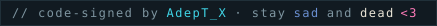

```text
adept@lab:~$ ./init --dossier
ACCESS GRANTED — loading public profile…
```

### Hi, I'm AdepT.

Software developer at `[REDACTED]` · founder of **[Adept Productions](https://adeptproductions.dev)** ·
I build small, focused software — and self-host everything I can get away with.

> There's always a challenge greater than the one you're currently facing — so why be afraid now?

```text
┌── THE HAND I'M PLAYING ──────────────────────────────┐
│  A♠  AdepTLab              Proxmox · 20+ services    │
│  K♠  adeptproductions.dev  the studio, self-hosted   │
│  A♥  dayplan               AI-assisted day planner   │
│  K♥  ConnectHub            E2EE-ready chat on Bun    │
│  ★   Syna                  AI persona (the JOKER)    │
└── full deck → me.adeptproductions.dev ───────────────┘
```

```text
adept@lab:~$ fastfetch --all-rigs

╭── syna · the battlestation
│ 💿 OS:       SynaOS (CachyOS base) · Hyprland
│ ⚙️ CPU:      Ryzen 9 9950X3D (32) @ 5.76 GHz
│ 🎮 GPU:      RTX 5090 (+ GTX 1080 → VMs)
│ 🧮 Memory:   64 GiB DDR5
│ 👻 Term:     Ghostty · JetBrains Mono
╰── 🎨 Theme:  Akane 🔴🟠🟡🟢🔵🟣⚪⚫

╭── adeptlab · the server room
│ 🖥️ Platform: Proxmox VE · 20+ LXCs & VMs
│ ⚡ CPU/GPU:  Ryzen 9 9950X3D · RTX 5070 Ti
│ 💾 Storage:  2×20 TB ZFS mirror + NVMe + DAS
│ 🌐 Network:  Cloudflare Tunnel + Tailscale
╰── 🚀 Serves: adeptproductions.dev + me.
```

#### // comms
[the studio](https://adeptproductions.dev) · [the dossier](https://me.adeptproductions.dev) · [email](mailto:hello@adeptproductions.dev) · Discord: `AdeptOfficial`

```text
adept@lab:~$ cat /etc/motd
BTR S2 is here. POGGERS.

adept@lab:~$ spotify --now-playing --loop
weigh down on me, stay 'til morning
way down, would you say I'm worthy?
```

## // codesign


<p align="right"></p>
